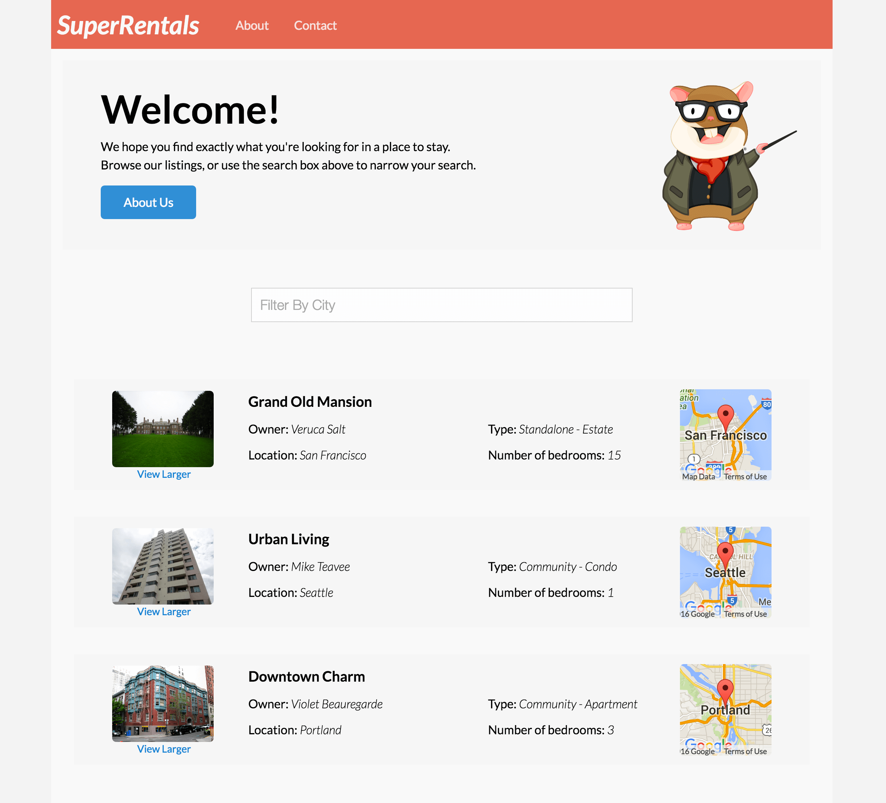

To demonstrate the basic setup and processing of an Ember application, this
section will walk through building an Ember application for a property rental
site called Super Rentals. It will start with a homepage, an about page, and a
contact page.

Let's take a look at the application from the user perspective before we get
started.

We arrive at the homepage which shows a list of rentals. From here, we will be
able to navigate to an about page and a contact page.

Before we start building the three pages for our app, we are going to clear out
the contents of the `app/templates/application.hbs` file and only leave the
`{{outlet}}` code in place. We'll talk more about the role of the
`application.hbs` file after our site has a few routes.

Now, let's start by building our "about" page. Remember, whe nthe URL path
`/about` is loaded, the router will map the URL to the route handler of the same
name, `about.js`. The route handler then loads a template.
