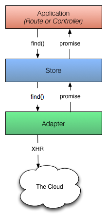
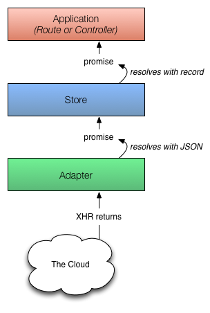
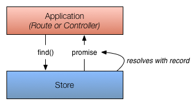

Ember ships with complete tools to help you connect your front end application
to a back end server of your choice. Users get a speedy
interface that displays consistent information. Developers get to skip writing
server requests and managing state themselves.

Those tools are:
- Models, which define the types of record available in your app, their
attributes, and their relationships
- The Store, a local cache of data that is kept updated
as new back end serve requests are made. Your app UI automatically updates to
display the latest information in the Store.
- Ember Data Adapters, where you specify the URLs that requests should go to
- Ember Data Serializers, where you can customize the text of requests in cases
where the back end has nonstandard formatting

Although most examples in these Guides focus on RESTful HTTP requests, Ember
Data can be configured to fit almost any back end structure, like plain JSON,
Websockets, GraphQL, and more. By extension, it can be used whether you have
a relational database or a not.

### Step by step initial setup

First, define a Model for each kind of record that should be available in your
app. Anything that a user should be able to create, see, edit, or delete should
have a Model for it. For example, a photo sharing application might have a
`Photo` model to represent an individual photo, and a `PhotoAlbum` that
represents a group of photos. The `Photo` would have attributes like date and
location, while the `PhotoAlbum` would have fields like category or title.
Generally, the names of your models and their attributes should be close to
the record types and fields in your database. Model files do not hold any data
in them, but rather just define what kinds of data should go into the app.

If you've been reading other
sections of the guides, you should know that there's a big difference between
Ember Data Models and the model function that is found in most routes. The Ember
Data Model describes what kinds of fields are available for a type of record,
and it's defined once in its own file. The model function (aka hook) is found
in many route files, and it's usually responsible for looking up data in the
store.

Next, create an adapter and set the URL that your back end requests should go
to. When your app makes requests, by default they will use
the URL in your adapter plus the plural model name. Your adapter will follow
JSONAPI standards by default, but you have many options. Ember has JSON API, REST
and JSON adapters available out of the box. There is [an entire
ecosystem of community-built adapters][adapters] that allow your Ember app to
talk to different types of servers without you writing any networking code.
Or, if you need to, you can write your own custom adapter.

[adapters]: http://emberobserver.com/categories/ember-data-adapters

Time to create a serializer, if you even need one. If your back end follows
JSONAPI specification, you are good to go. If not, or if you have some front end
model names that are different than the record types in your back end, you can
write a custom serializer. The serializer has two jobs - formatting your
outgoing requests to match what your server expects, and processing the response
so that it can be matched up correctly with an Ember Data Model. Similar to
adapters, you can use one of Ember's out of the box options, find a community
serializer, or write your own.

Both adapters and serializers can be customized for each kind of Model, but
most new apps can just define one application-wide adapter that is used for
all record types. These tools let you completely change how your API is
implemented without impacting your front end Ember application code.

Now you're ready to start making requests. If you have done front end
development before, you may be familiar with writing requests by hand, on an
as-needed and repeated basis... but here, Ember Data does all the heavy lifting.
All you need to do is call a few special methods (like `findAll`, `findRecord`,
`save`, and `destroy`) and the requests will be constructed for you, using
information from your Models, Serializer, and Adapter.

When response is received from the back end server, it is matched up with a
Model and saved in the Store. The store is a local cache of data that is kept
up to date as you make more requests. This means that anywhere in your
app that you need to reference or display data, you're looking at a single
source of truth. It's like having a mini, temporary database available in the
browser. Ember Data is smart enough that if you have redundant requests
throughout your app, it will look in the Store first for the records, and
save you an unnecessary server request. This is one of the ways that Ember
apps achieve a speedy, smooth interface.

All of these tools combined lead to fewer lines of code, high maintainability
and extensibility, and an easy pathway for supporting changes made to your back end.

## Why is JSON API the default?

You can significantly reduce the amount of code you need to write and
maintain by relying on Ember's conventions. Since these conventions
will be shared among developers on your team and in the community,
following them leads to code that is easier to maintain and understand.

Ember Data is
designed to work out of the box with [JSON API][json-api]. JSON API is a
formal specification for building conventional, robust, and performant
APIs that allow clients and servers to communicate model data.

[json-api]: http://jsonapi.org

JSON API standardizes how JavaScript applications talk to servers, so
you decrease the coupling between your frontend and backend, and have
more freedom to change pieces of your stack.

As an analogy, JSON API is to JavaScript apps and API servers what SQL is
to server-side frameworks and databases. Popular frameworks like Ruby on
Rails, Laravel, Django, Spring and more work out of the box with many
different databases, like MySQL, PostgreSQL, SQL Server, and more.

Frameworks (or apps built on those frameworks) don't need to write
lots of custom code to add support for a new database; as long as that
database supports SQL, adding support for it is relatively easy.

So too with JSON API. By using JSON API to communicate between your Ember
app and your server, you can entirely change your backend stack without
breaking your frontend. And as you add apps for other platforms, such as
iOS and Android, you will be able to leverage JSON API libraries for
those platforms to easily consume the same API your Ember app uses.

## Architecture and Asynchronous Requests

The first time your application asks the store for a record, the store
sees that it doesn't have a local copy and requests it from your
adapter. Your adapter will go and retrieve the record from your
persistence layer; typically, this will be a JSON representation of the
record served from an HTTP server.

As illustrated in the diagram above, the adapter cannot always return the
requested record immediately. In this case, the adapter must make an
_asynchronous_ request to the server, and only when that request finishes
loading can the record be created with its backing data.

Because of this asynchronicity, the store immediately returns a
_promise_ from the `find()` method. Similarly, any requests that the
store makes to the adapter also return promises.

Once the request to the server returns with a JSON payload for the
requested record, the adapter resolves the promise it returned to the
store with the JSON.

The store then takes that JSON, initializes the record with the
JSON data, and resolves the promise returned to your application
with the newly-loaded record.

Let's look at what happens if you request a record that the store
already has in its cache.

In this case, because the store already knew about the record, it
returns a promise that it resolves with the record immediately. It does
not need to ask the adapter (and, therefore, the server) for a copy
since it already has it saved locally.

---

Models, records, adapters and the store are the core concepts you
should understand to get the most out of Ember Data. The following
sections go into more depth about each of these concepts, and how to
use them together.
